<p align="center">
  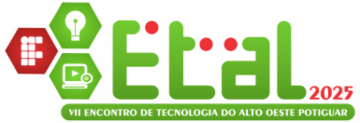
  &nbsp;&nbsp;&nbsp;&nbsp;
  <picture>
    <source media="(prefers-color-scheme: dark)" srcset="docs/marca/nadic-logo-claro.svg">
    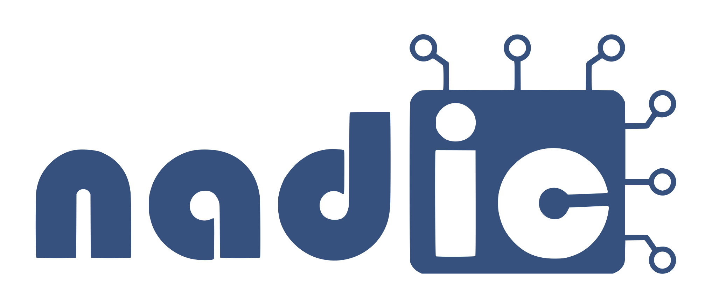
  </picture>
</p>

<h1 align="center">ETAL Connect</h1>

<p align="center">
  Crachá, programação, presença por QR e o mapa 3D do campus num app só.<br>
  Proposta do <b>NADIC</b> para o <b>ETAL</b>, no IFRN Campus Pau dos Ferros.
</p>

<p align="center">
  <a href="docs/README.md"><b>Documentação</b></a> ·
  <a href="docs/pdf/ETAL-Connect-apresentacao.pdf">Apresentação (PDF)</a> ·
  <a href="prototipo/qrs.html">QR Codes de teste</a> ·
  <a href="#rodar">Rodar</a>
</p>

<p align="center">
  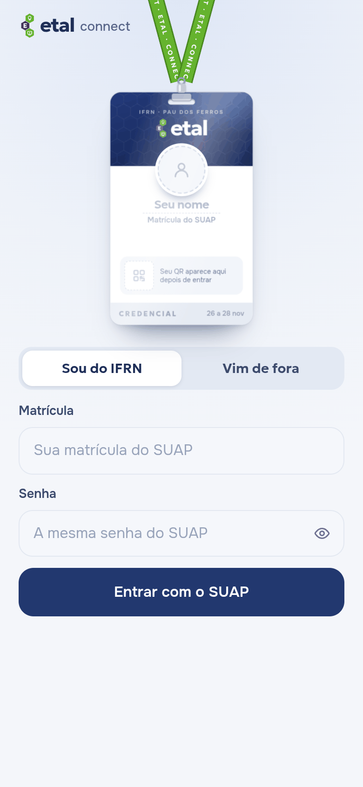
  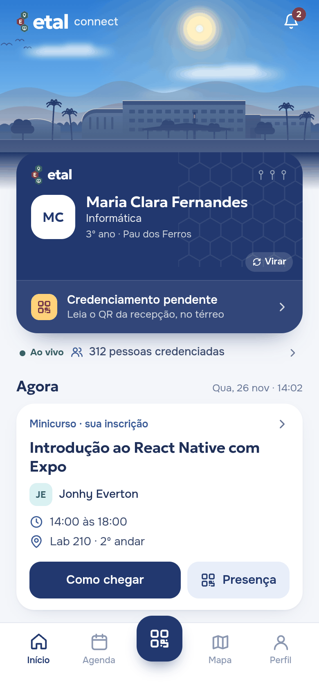
  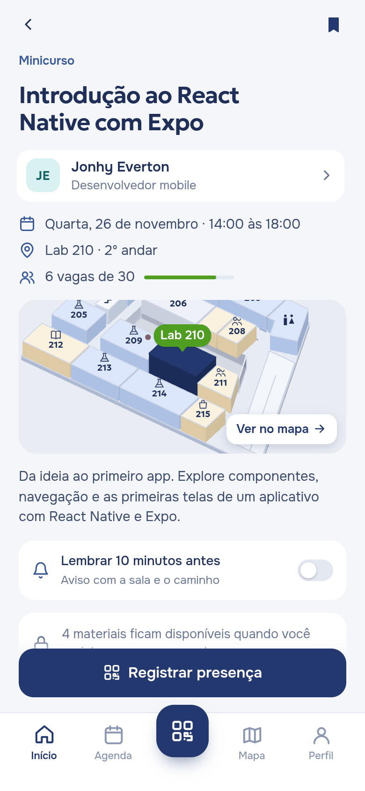
  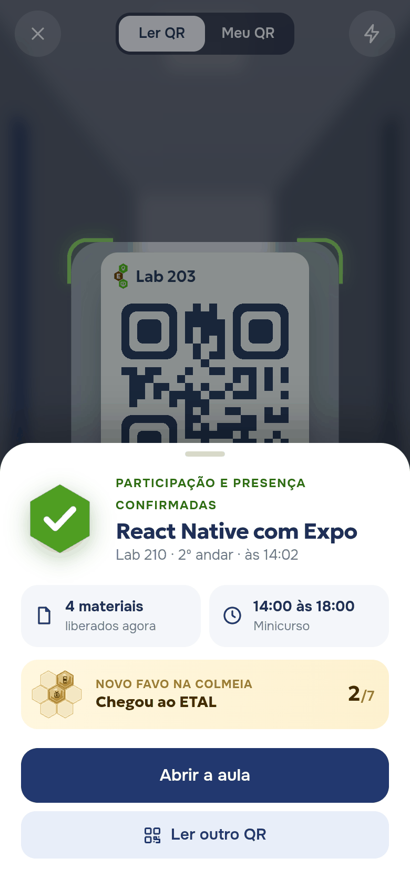
  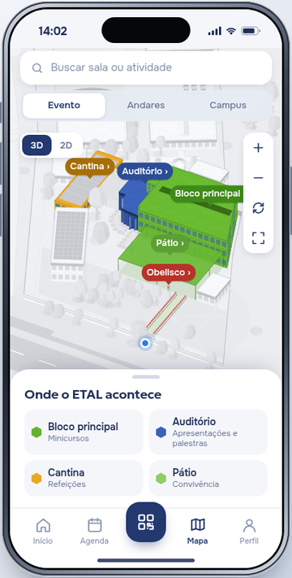
</p>

## O que o app faz

- **Entrada pelo crachá.** Os dados aparecem no crachá enquanto a pessoa digita; puxar o crachá para baixo abre o app. Quem é do IFRN entra pelo SUAP (biblioteca [suapy](https://github.com/kellyson71/suapy)); quem vem de fora cria uma conta de visitante.
- **Programação e agenda.** Três dias de evento, filtros por tipo, atividades salvas, palestrantes e materiais liberados depois da presença.
- **Presença por QR.** Credenciamento na recepção e presença em cada atividade pela leitura do QR da sala.
- **Mapa 3D do campus.** Feito a partir do levantamento, da planta de 2012 e de fotos. O modo **Evento** é um mapa ilustrado, com as partes do evento em cores e ícones; o modo **Campus** mostra o modelo realista, inclusive o bloco por dentro. **Como chegar** anima o caminho como um GPS, da portaria até a porta da sala, subindo escada ou rampa. Tocar duas vezes num prédio mostra o que acontece nele.
- **Publicações.** Fotos, comentários e conversa geral do evento (guardados no aparelho, sem servidor).
- **Lembretes e uso sem internet.** Aviso dez minutos antes, com sala e caminho. O app é instalável (PWA) e abre sem rede.
- **Painel da organização** (`admin.html`): lotação das salas ao vivo, troca de sala pela planta, credenciamento manual, atividades, materiais e avisos que chegam ao app.

<p align="center">
  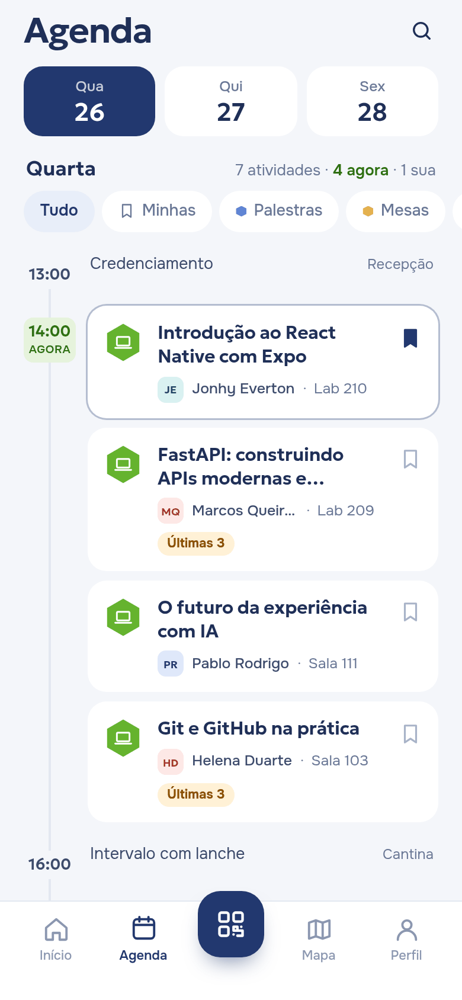
  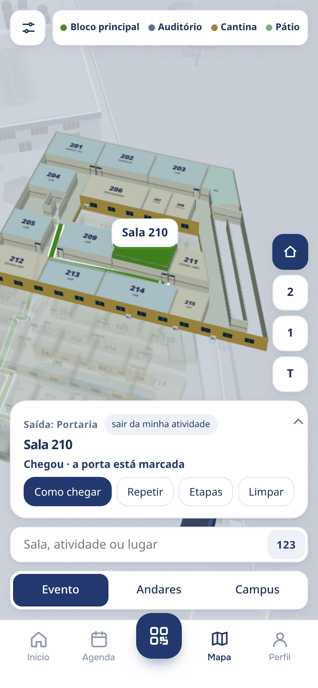
  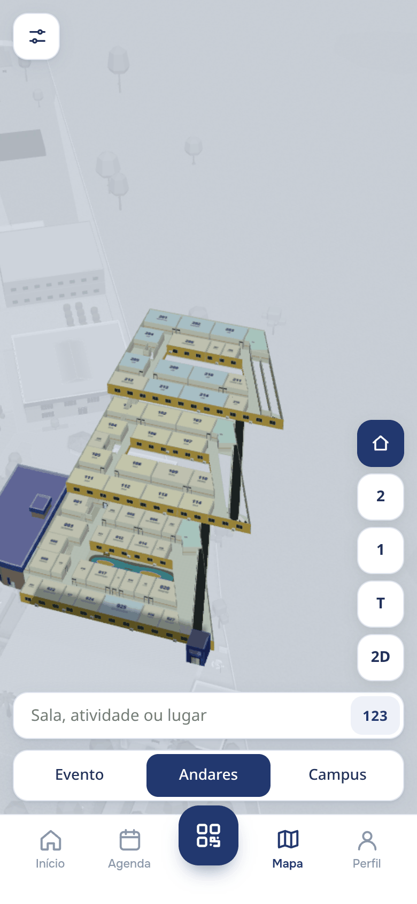
  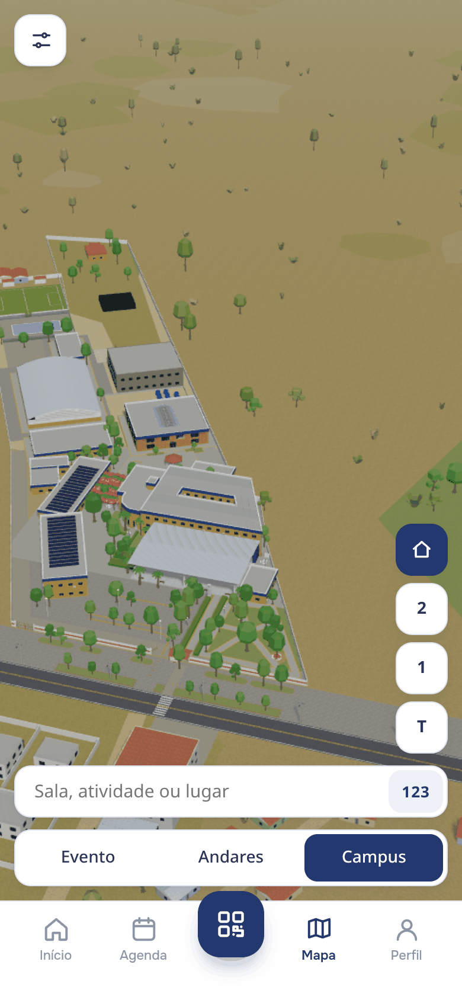
</p>
<p align="center">
  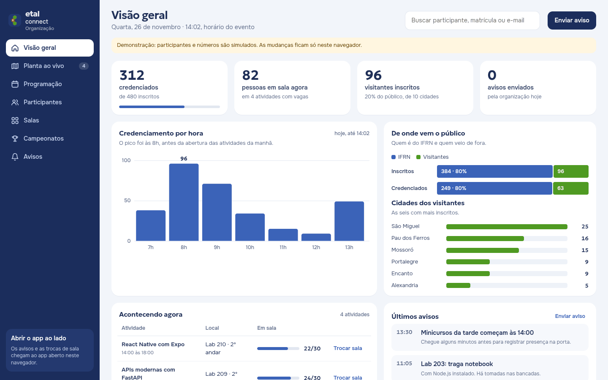
</p>

## Rodar

Precisa de Python 3 (e de internet na primeira vez, para instalar a suapy).

```sh
npm run prototipo        # ou: sh prototipo/rodar.sh
```

- App: http://127.0.0.1:8770 · Painel: http://127.0.0.1:8770/admin.html · QR Codes de teste: http://127.0.0.1:8770/qrs.html
- **No celular, pelo Wi-Fi:** `REDE=<IP do computador> HTTPS=1 sh prototipo/rodar.sh` e abra `https://<IP>:8770`. O certificado é local: o navegador avisa uma vez (*Avançado → Continuar*). É o modo em que a câmera do leitor de QR abre.
- **Com a API** (FastAPI, SQLite de demonstração do VII ETAL): `npm run demo`. Detalhes em [`backend/README.md`](backend/README.md).
- **Sem servidor:** `npm run export:html` gera `dist/etal-connect.html`, um arquivo só que abre com duplo clique (sem login do SUAP). Ele também vai anexado a cada versão publicada no GitHub.
- **Atalhos:** `?tela=home|agenda|atividade|mapa|rota|org|sobre…`, `?mapa=classico`, `?tema=escuro`, `?fps=1`.

## Estrutura

| Pasta | O que tem |
|---|---|
| `prototipo/` | O app: telas (`app.js`, `app.css`), painel da organização (`admin.*`), publicações (`community.*`), mapa clássico em Canvas (`campus3d.js`), dados de exemplo (`data.js`), servidor local com login do SUAP (`server.py`) e PWA (`sw.js`) |
| `mapa3d/` | O mapa 3D (three.js): modo Evento ilustrado, modo Campus, andares e rota. Empacotado no app por `npm run pwa` |
| `backend/`, `deploy/` | API FastAPI (SUAP, presença por QR assinado, avisos, painel) e implantação com Caddy e PostgreSQL |
| `api/` | Entrada da API na Vercel |
| `dados/` | Levantamento do campus, planta do bloco principal e prancha dos três andares |
| `docs/` | [Documentação](docs/README.md): apresentação, referência técnica, PDFs e histórico |
| `referencias/` | KML do levantamento, croquis da planta e modelos 3D de terceiros |
| `scripts/` | `planta/`, `campus/`, `app/` (cache offline e exportação), `docs/` (apresentação e PDFs) e `demo/` |

```sh
npm test           # rotas do mapa, publicações e conferência da planta
npm run lint       # ESLint
npm run format     # Prettier
npm run planta     # regenera a planta do bloco e confere as regras
npm run pwa        # atualiza o mapa e o cache offline depois de mudar o protótipo
npm run docs:pdf   # gera a apresentação e os PDFs da documentação
```

O fluxo de trabalho segue o git flow: cada assunto nasce num ramo `feature/*` a partir do `develop`, e as versões saem por `release/x.y.z` para a `main`, com tag. O que mudou em cada versão está no [CHANGELOG](CHANGELOG.md).

## Real e exemplo

O app mostra isso em Perfil → Sobre este protótipo.

- **Real:** login pelo SUAP (a senha não é gravada), o mapa do campus e a planta do bloco, os textos do ETAL, do NADIC e do IFRN, conta de visitante, lembretes e uso sem internet.
- **Programação:** 15 atividades seguem a programação pública do VII ETAL (26 a 28 de novembro de 2025); outras seis (campeonatos, credenciamento e uma oficina) são de demonstração. Salas, vagas, presença, certificados, materiais, avisos e os números do painel são exemplos. Nada disso é oficial.
- **Aproximado:** alturas dos prédios, posição do obelisco e o entorno do campus.

## Créditos

Árvores e casas: Kenney (CC0). Personagem e carro do passeio: [Sketchbook](https://github.com/swift502/Sketchbook) (MIT). Leitura de QR: [zxing-wasm](https://github.com/Sec-ant/zxing-wasm) (MIT) e [jsQR](https://github.com/cozmo/jsQR) (Apache 2.0); geração: [node-qrcode](https://github.com/soldair/node-qrcode) (MIT). Fontes: Geologica e Onest. Plantas de 2012: dissertação de Larissa Leiros de Souza ([UFRN](https://repositorio.ufrn.br/server/api/core/bitstreams/2be1d619-02aa-4c23-aa6b-4d65aa238aba/content)). Informações do evento: sites do ETAL, do NADIC e do IFRN Campus Pau dos Ferros.

O histórico no Git começa em 07/11/2026; os commits anteriores foram montados pelas datas de modificação dos arquivos.
