# ETAL Connect

Proposta de aplicativo para o **ETAL**, o Encontro de Tecnologia do Alto Oeste Potiguar, no IFRN Campus Pau dos Ferros. O NADIC desenvolve o app em parceria com o IFRN e o ETAL. A referência de funcionamento é o app do GO!RN: crachá, programação, presença, mapa e avisos num lugar só.

<p>
  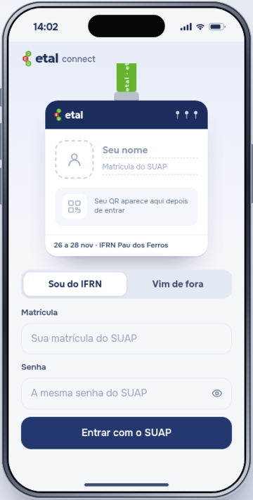
  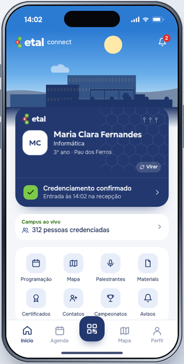
  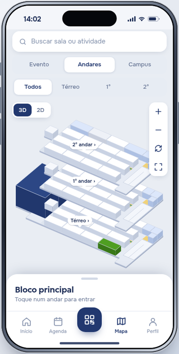
  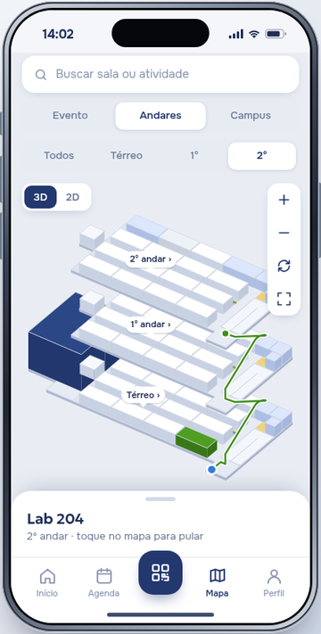
</p>

## O que o app faz

- **Entrada pelo crachá.** A tela de entrada é um crachá em branco no cordão. Enquanto a pessoa digita, os dados aparecem nele; ao entrar, ele vira e mostra o crachá preenchido. Puxar o crachá para baixo abre o app. Quem é do IFRN entra com a matrícula, e nome, foto e curso vêm do SUAP pela biblioteca [suapy](https://github.com/kellyson71/suapy). Quem vem de fora cria uma conta de visitante.
- **Crachá e credenciamento.** O crachá vira e mostra o QR. O credenciamento e a presença em cada atividade são registrados pela leitura do QR na sala.
- **Programação.** Três dias de evento, com filtros, atividades salvas, palestrantes e materiais liberados depois da presença.
- **Mapa do campus em 3D.** O campus inteiro foi feito a partir de um levantamento no Google Earth e de fotos. O modo Evento destaca o bloco principal, o auditório, a cantina, o pátio e o obelisco. "Como chegar" traça a rota da portaria até a porta da sala e escolhe a entrada e a escada ou rampa mais rápidas.
- **Quatro versões do 3D.** Completo, médio, leve e 2D. O app mede o aparelho e escolhe a versão; o teste de desempenho em Perfil → Personalizar mostra os quadros por segundo de cada uma.
- **Lembretes.** Dez minutos antes da atividade, o app avisa com a sala, o andar e quantos minutos a pé ela fica da entrada, também como notificação do sistema.
- **Funciona sem internet.** É instalável (PWA) e guarda o app no aparelho, inclusive o mapa. Isso conta porque a internet do campus costuma cair com o evento cheio.
- **Painel da organização no computador** (`admin.html`). Visão geral com gráficos, planta ao vivo com a lotação de cada sala, programação com troca de sala, participantes com credenciamento manual e exportação em CSV, e envio de avisos. O que a equipe faz ali chega ao app aberto no mesmo navegador. O celular tem uma versão resumida do painel.
- **Retrospectiva, colmeia de conquistas, campeonatos e temas.**

| | | | |
|---|---|---|---|
| 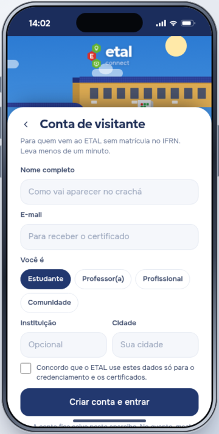 | 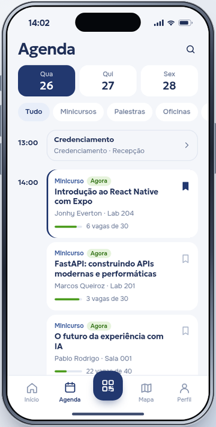 | 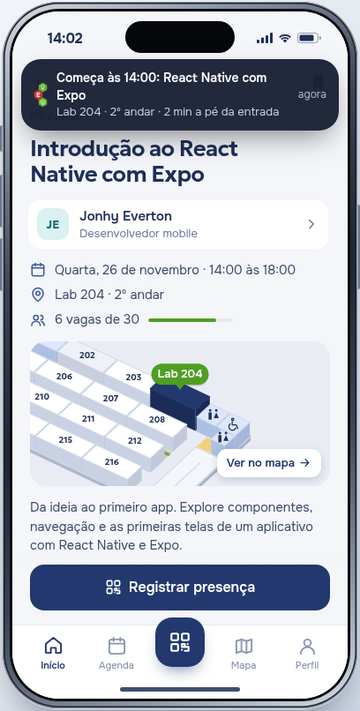 | 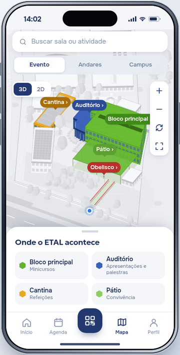 |
| Crachá preenchido | Agenda | Lembrete | Mapa: modo Evento |
| 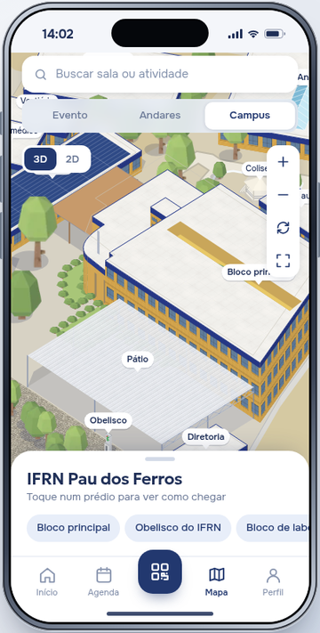 | 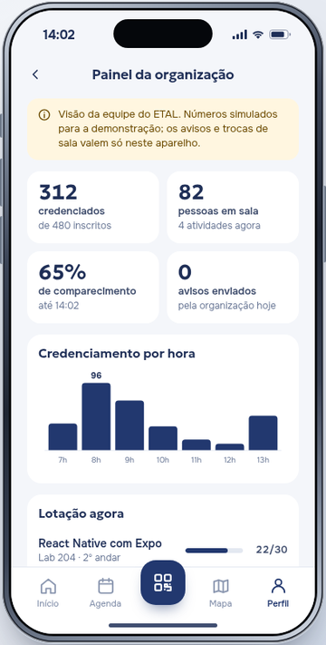 | 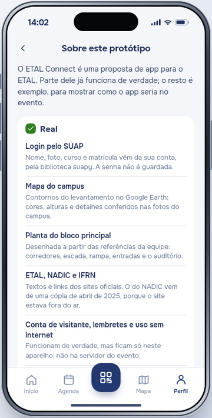 | 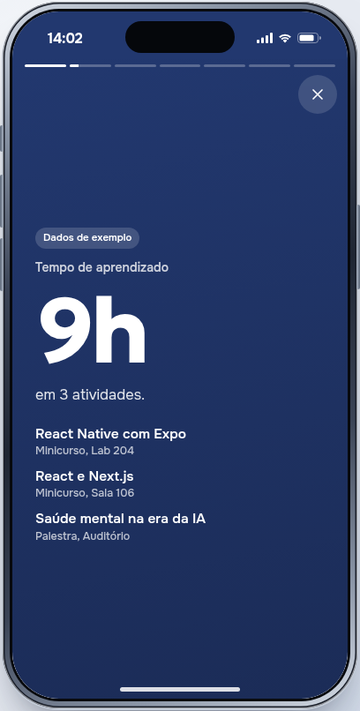 |
| Campus com as cores reais | Painel da organização | Real e exemplo | Retrospectiva |

### Painel da organização

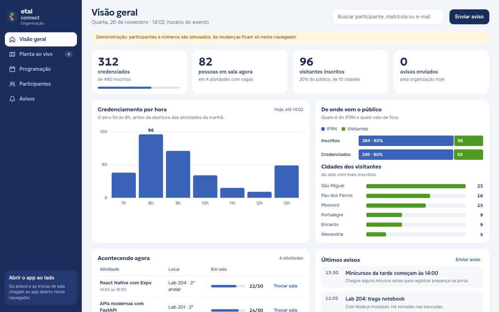

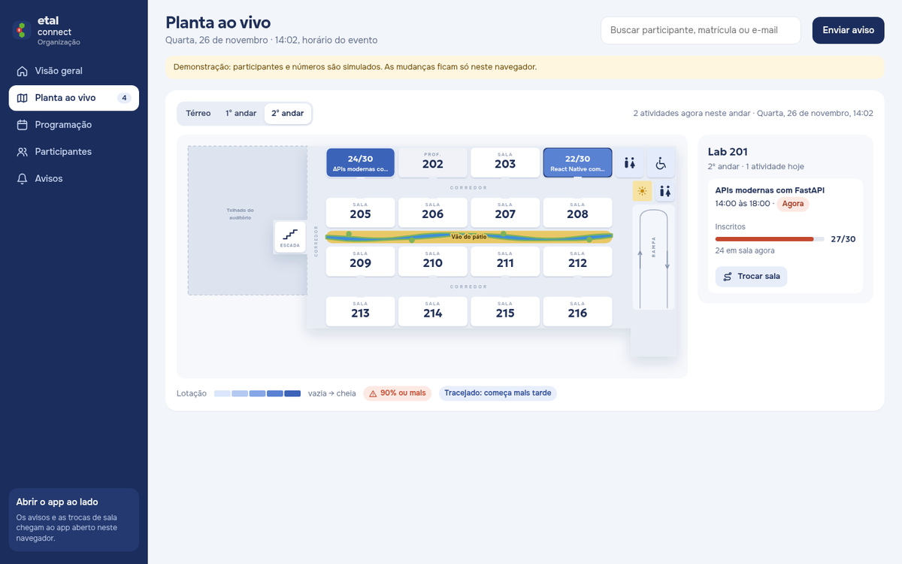

### Como a entrada foi escolhida

Pesquisamos como os apps de eventos fazem a entrada:

- **Doity, Brella e Whova** pedem o e-mail da inscrição.
- **Bizzabo e Guidebook** dispensam a senha e mandam um link ou código.
- **Web Summit Rio** guarda o ingresso como um QR no app.
- **Whova** e outros apresentam o app antes de pedir conta.

Com base nisso, testamos três propostas: Cartaz, Crachá e Explorar. Ficou a do crachá, que deixa claro para que serve a conta.

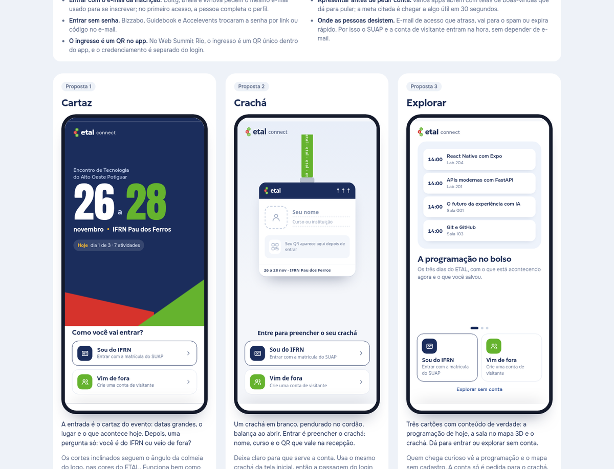

## Rodar

Precisa de Python 3 e de acesso à internet na primeira execução.

```sh
npm run prototipo        # ou: sh prototipo/rodar.sh
```

Abra http://127.0.0.1:8770 para o app e http://127.0.0.1:8770/admin.html para o painel da organização. Na primeira vez, o script cria o ambiente Python e instala a suapy.

Para abrir no celular pela mesma rede Wi-Fi:

```sh
REDE=192.168.0.10 sh prototipo/rodar.sh   # troque pelo IP do computador
```

Pelo Wi-Fi a conexão é HTTP, sem criptografia. Use só contas de teste. A instalação e o uso sem internet exigem HTTPS ou o endereço 127.0.0.1.

**Sem servidor:** `npm run export:html` gera o `index.html` da raiz, um arquivo único que abre por duplo clique. Nele o login do SUAP não funciona, mas dá para entrar como visitante ou com dados de exemplo.

**Atalhos de teste:** `?tela=` abre direto numa tela (`home`, `agenda`, `atividade`, `mapa`, `bloco`, `campus`, `rota`, `org`, `sobre`, `visitante`, `perf`, `retro`…). Também há `?qualidade=alta|media|leve|simples`, `?fps=1` e `?tema=dark`.

## Estrutura

| Pasta | O que tem |
|---|---|
| `prototipo/` | O app: `index.html`, `app.js` (telas), `admin.html` e `admin.js` (painel da organização), `app.css`, `campus3d.js` (motor do mapa em Canvas), `data.js` (programação), `sw.js` e `manifest.webmanifest` (PWA), `server.py` (servidor e login no SUAP) |
| `scripts/` | Geradores: planta do bloco (`build-principal-plan.py`, conferida por `check-principal-plan.py`), campus a partir do KML, sprites renderizados no Blender, cache offline (`build-pwa.py`) e exportação (`export-prototipo.py`) |
| `referencias/` | Levantamento do campus em KML, imagens de referência da planta e modelos 3D (CC0) |
| `docs/` | Contexto, fluxos, regras do mapa, propostas visuais e os prints |
| `modelo-3d/` | Cópia congelada do mapa, de antes das otimizações |
| `app/` | Primeira versão, em React (Vinext). Ficou como legado |

Comandos úteis:

```sh
npm run planta   # regenera a planta do bloco e confere as regras
npm run pwa      # atualiza a versão do cache offline depois de mudar o protótipo
```

## Real e exemplo

O app mostra isso em Perfil → Sobre este protótipo.

- **Real:**
  - O login pelo SUAP, com nome, foto, curso e matrícula. A senha não é gravada nem registrada.
  - O mapa do campus e a planta do bloco principal.
  - Os textos do ETAL, do NADIC e do IFRN.
  - A conta de visitante, os lembretes e o uso sem internet. Esses três funcionam de verdade, mas ficam só no aparelho.
- **Exemplo:**
  - Seis atividades seguem o VII ETAL (novembro de 2025). As outras, e os nomes dos palestrantes delas, são inventados.
  - A distribuição das atividades pelas salas e as vagas.
  - Credenciamento, presença, certificados e materiais. Não há integração oficial.
  - Campeonatos, avisos e os números do painel da organização.
- **Aproximações:**
  - As alturas dos prédios.
  - A posição do obelisco e o desenho do riacho no pátio.
  - O entorno do campus.

## Créditos

- Modelos de árvores, arbustos e casas: Kenney (Nature Kit e City Kit Suburban), CC0. Detalhes em `referencias/modelos/CREDITOS.txt`.
- Fontes: Geologica e Onest, via Google Fonts.
- Informações do evento: sites do ETAL, do NADIC e do IFRN Campus Pau dos Ferros.

## Histórico

O versionamento com git começou em 07/11/2026. Os commits anteriores a essa data foram montados a partir das datas de modificação dos arquivos. Cada commit reúne os arquivos modificados pela última vez naquele horário, no estado em que ficaram; as versões intermediárias não foram guardadas.
