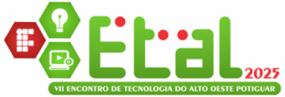
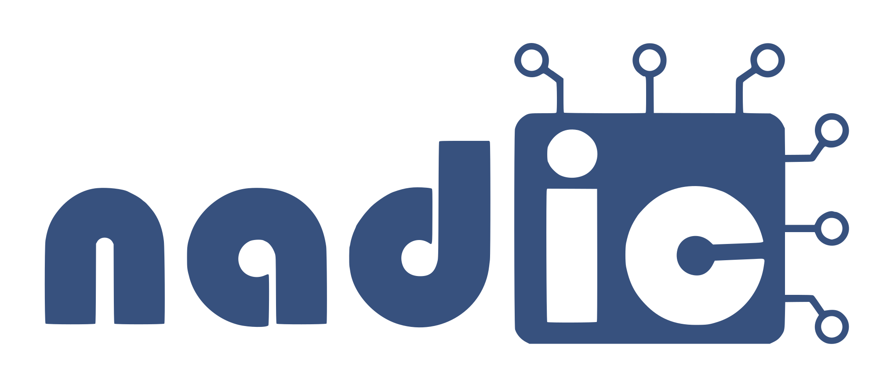
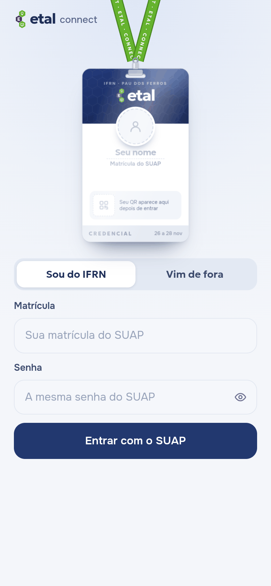
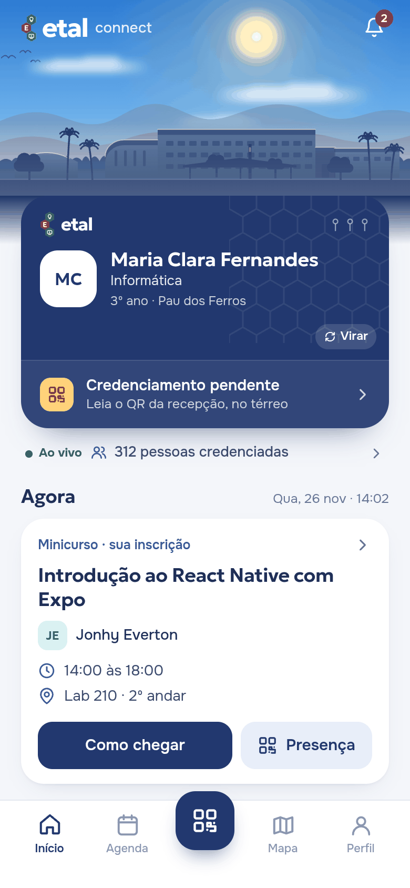
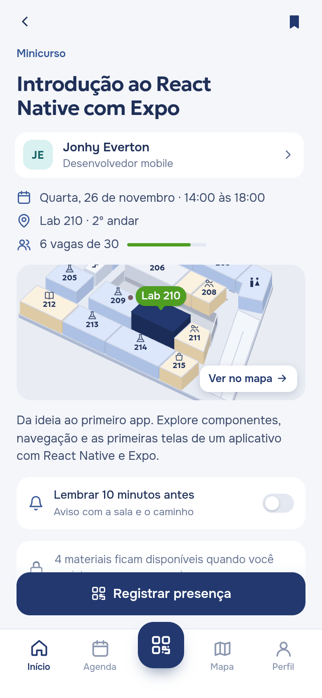
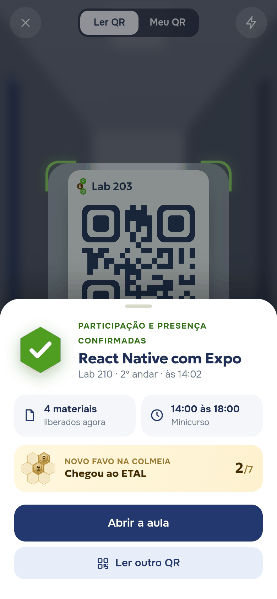
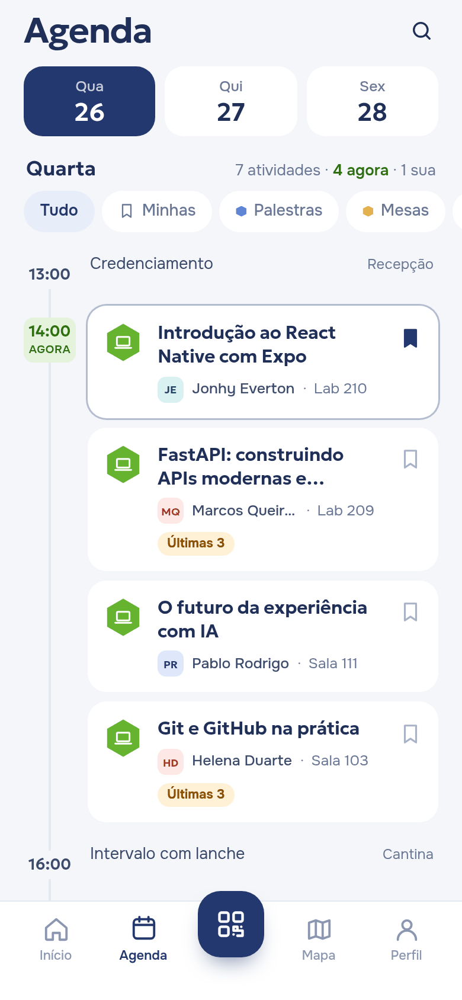
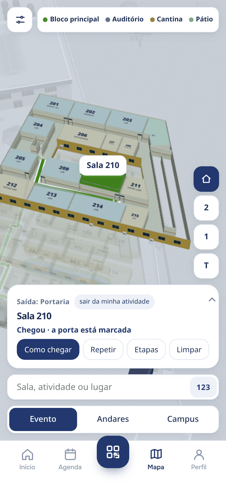
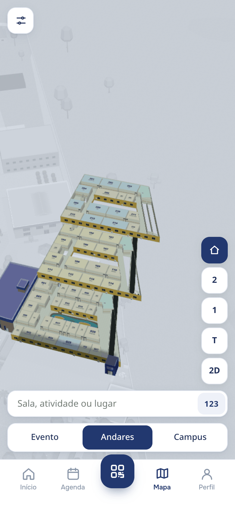
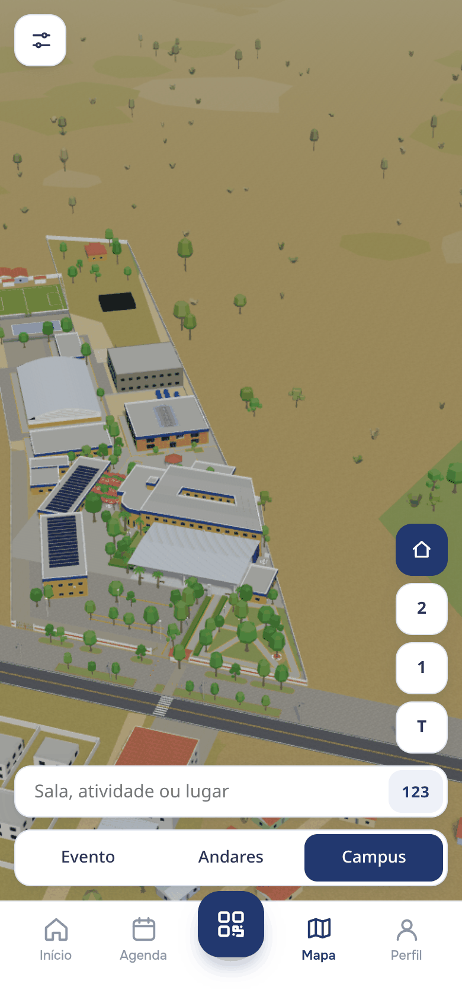

<p align="center">
  
  &nbsp;&nbsp;&nbsp;&nbsp;
  <picture>
    <source media="(prefers-color-scheme: dark)" srcset="docs/marca/nadic-logo-claro.svg">
    
  </picture>
</p>

<h1 align="center">ETAL Connect</h1>

<p align="center">
  Crachá, programação, presença por QR e o mapa 3D do campus num app só.<br>
  Proposta do <b>NADIC</b> para o <b>ETAL</b>, no IFRN Campus Pau dos Ferros.
</p>

<p align="center">
  <a href="docs/README.md"><b>Documentos e PDFs</b></a> ·
  <a href="docs/pdf/ETAL-Connect-apresentacao.pdf">Apresentação (PDF)</a> ·
  <a href="prototipo/qrs.html">QR Codes de teste</a> ·
  <a href="#rodar">Rodar</a>
</p>

<p align="center">
  
  
  
  
  
</p>

## O que o app faz

- **Entrada pelo crachá.** Os dados aparecem no crachá enquanto a pessoa digita; puxar o crachá para baixo abre o app. Quem é do IFRN entra pelo SUAP (biblioteca [suapy](https://github.com/kellyson71/suapy)); quem vem de fora cria uma conta de visitante.
- **Programação e agenda.** Três dias de evento, filtros, atividades salvas, palestrantes e materiais liberados depois da presença.
- **Presença por QR.** Credenciamento na recepção e presença em cada atividade pela leitura do QR da sala.
- **Mapa 3D do campus.** Feito a partir do levantamento e de fotos. O modo **Evento** mostra só o campus, com as partes do evento em cores; o modo **Campus** mostra tudo, inclusive o bloco por dentro. **Como chegar** traça a rota da portaria até a porta da sala, pela rampa ou pela escada. O mapa ainda esconde um segredo.
- **Lembretes e uso sem internet.** Aviso dez minutos antes, com sala e caminho. O app é instalável (PWA) e abre sem rede.
- **Painel da organização** (`admin.html`): lotação das salas ao vivo, troca de sala, credenciamento manual e avisos que chegam ao app.

<p align="center">
  
  
  
  
</p>
<p align="center">
  
</p>

## Rodar

Precisa de Python 3 (e de internet na primeira vez, para instalar a suapy).

```sh
npm run prototipo        # ou: sh prototipo/rodar.sh
```

- App: http://127.0.0.1:8770 · Painel: http://127.0.0.1:8770/admin.html · QR Codes de teste: http://127.0.0.1:8770/qrs.html
- **No celular, pelo Wi-Fi:** `REDE=<IP do computador> HTTPS=1 sh prototipo/rodar.sh` e abra `https://<IP>:8770`. O certificado é local (gerado com `mkcert`): o navegador avisa uma vez, toque em *Avançado → Continuar*. Em HTTPS a câmera do leitor de QR funciona. Sem `HTTPS=1` o servidor fica em HTTP e a câmera do app não abre (o navegador não deixa); a câmera do próprio celular ainda lê os QRs da página de teste. Use só contas de teste.
- **QR Codes de teste** (`/qrs.html`, aberto no computador): leia com o leitor do app (modo HTTPS) ou com a câmera do celular. Cada QR é um link `?qr=etal:<atividade>`. A câmera do celular abre o app e, depois da entrada, faz a leitura de exemplo. Com a API ligada, os QRs assinados ficam em `homologacao.html`.
- **Sem servidor:** `npm run export:html` gera o `index.html` da raiz, que abre com duplo clique (sem login do SUAP).
- **Atalhos:** `?tela=home|agenda|atividade|mapa|rota|org|sobre…`, `?mapa=classico`, `?tema=dark`, `?fps=1`.

## Estrutura

| Pasta | O que tem |
|---|---|
| `prototipo/` | O app (telas em `app.js`, painel em `admin.js`, servidor e login do SUAP em `server.py`, PWA) |
| `mapa3d/` | O mapa 3D (three.js), empacotado no app por `npm run pwa` |
| `backend/`, `deploy/` | API FastAPI (SUAP, presença por QR assinado, avisos) e implantação com Caddy e PostgreSQL |
| `docs/` | [Documentos e PDFs](docs/README.md), prints e a apresentação |
| `scripts/` | Planta do bloco, cache offline, exportações, prints e PDFs |

```sh
npm run planta     # regenera a planta do bloco e confere as regras
npm run pwa        # atualiza o cache offline depois de mudar o protótipo
npm run docs:pdf   # gera os PDFs da documentação
```

## Real e exemplo

O app mostra isso em Perfil → Sobre este protótipo.

- **Real:** login pelo SUAP (a senha não é gravada), o mapa do campus e a planta do bloco, os textos do ETAL, do NADIC e do IFRN, conta de visitante, lembretes e uso sem internet.
- **Exemplo:** seis atividades seguem o VII ETAL (novembro de 2025); as outras são inventadas. Salas, vagas, presença, certificados, materiais, campeonatos, avisos e os números do painel. Nada disso é oficial.
- **Aproximado:** alturas dos prédios, posição do obelisco e o entorno do campus.

## Créditos

Árvores e casas: Kenney (CC0). Personagem e carro do passeio: [Sketchbook](https://github.com/swift502/Sketchbook) (MIT). Gerador de QR: [node-qrcode](https://github.com/soldair/node-qrcode) (MIT). Fontes: Geologica e Onest. Plantas de 2012: dissertação de Larissa Leiros de Souza (UFRN). Informações do evento: sites do ETAL, do NADIC e do IFRN Campus Pau dos Ferros.

O histórico no Git começa em 07/11/2026; os commits anteriores foram montados pelas datas de modificação dos arquivos.
