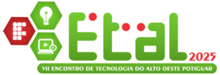
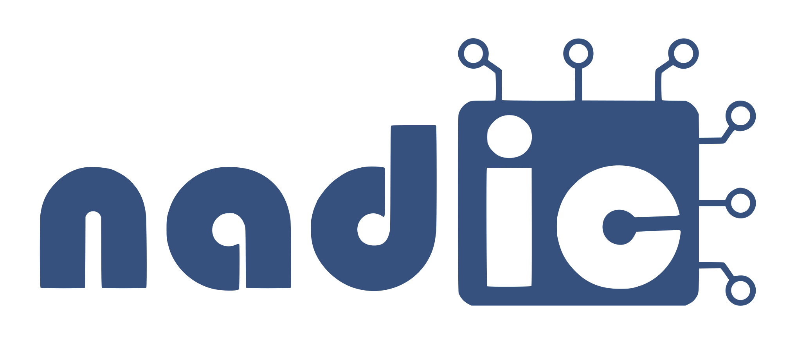

<p align="center">
  
  &nbsp;&nbsp;&nbsp;
  <picture>
    <source media="(prefers-color-scheme: dark)" srcset="marca/nadic-logo-claro.svg">
    
  </picture>
</p>

# Documentação do ETAL Connect

Tudo o que explica o projeto, num lugar só. Os PDFs abrem direto no GitHub; os HTML abrem no navegador a partir de uma cópia local do repositório (duplo clique, sem servidor).

## Para ler

| Documento | O que tem |
|---|---|
| **[Apresentação (PDF)](pdf/ETAL-Connect-apresentacao.pdf)** | O projeto em slides: o encontro, o participante, a organização, o mapa do campus real ao 3D, a presença por QR e o apêndice técnico (arquitetura, banco, API, PWA, rotas). |
| **[Referência técnica](tecnico/README.md)** | Requisitos, casos de uso, banco de dados, arquitetura, API, testes, mapa e fontes, PWA. |
| **[Comparação dos mapas (PDF)](pdf/ETAL-Connect-comparacao-dos-mapas.pdf)** | 20 pares de capturas: o mapa clássico (Canvas) e o mapa 3D (WebGL) vistos dos mesmos lugares. |
| **[Explorações visuais (PDF)](pdf/ETAL-Connect-exploracoes-visuais.pdf)** | As propostas de design que vieram antes do app atual: direções visuais, home e mapa, e as três entradas testadas. |

## Para apresentar

- [`apresentacao.html`](apresentacao.html): os slides interativos, com demonstrações do app e do mapa. Setas para navegar, botão de tela cheia.
- [`roteiro-apresentacao.html`](roteiro-apresentacao.html): o roteiro da fala, na mesma ordem dos slides.

## Referência técnica (`tecnico/`)

| Arquivo | Assunto |
|---|---|
| [01 Requisitos](tecnico/01-requisitos.md) · [02 Casos de uso](tecnico/02-casos-de-uso.md) | O que o app faz e para quem |
| [03 Banco de dados](tecnico/03-banco-de-dados.md) · [04 Arquitetura](tecnico/04-arquitetura.md) · [05 API](tecnico/05-api.md) | Como o sistema é montado |
| [06 Testes](tecnico/06-testes.md) | O que é testado e como rodar |
| [07 Mapa e fontes](tecnico/07-mapa-e-fontes.md) · [Referências do campus](tecnico/campus-referencias.md) | De onde vêm o campus, a planta e as alturas |
| [08 PWA e apresentação](tecnico/08-pwa-e-apresentacao.md) | Uso sem internet e como a apresentação é gerada |
| [Plano técnico](tecnico/plano-tecnico.md) | Rotas da API, implantação com Docker, segurança |
| [Demonstração do VII ETAL](tecnico/demo-vii-etal.md) · [Investigação dos eventos do SUAP](tecnico/investigacao-suap-eventos.md) | Cenário de demonstração e o que foi levantado no SUAP |

## Dados do campus (`../dados/`)

O levantamento do campus (`campus-survey.json`), a planta do bloco principal traçada sobre as plantas de 2012 (`principal-plan.json`) e a prancha dos três andares ([`bloco-principal.svg`](../dados/bloco-principal.svg)). A planta é editada em `scripts/planta/build-principal-plan.py` e gerada com `npm run planta`.

## Histórico

- [`historico/`](historico/): as explorações de design em HTML (fonte do PDF de explorações visuais).
- [`comparacao-modelos/`](comparacao-modelos/index.html): o registro lado a lado dos dois mapas, com os pares em JPG.
- [`prints/`](prints/): as capturas usadas no README.

## Gerar de novo

```sh
npm run docs        # apresentação (docs/apresentacao.html) e demonstrações isoladas do app
npm run docs:pdf    # PDFs desta pasta (Playwright, Chrome e pdfunite locais)
python3 scripts/docs/documentar-modelos.py --somente-documento   # comparação dos mapas (precisa dos PNGs originais)
python3 scripts/docs/capturar-prints.py                          # prints do README (com o protótipo rodando)
```

Antes de imprimir, as capturas de tela viram JPEG no tamanho em que aparecem (`scripts/docs/otimizar_pdf.py`): os PDFs ficam leves e o texto continua pesquisável. Os PNGs originais da comparação (75 MB) ficam só na máquina de quem gera; os hashes deles estão em `comparacao-modelos/evidencias.json`.

A dissertação de 2012 que deu as plantas do bloco (Larissa Leiros de Souza, UFRN) está no [repositório da UFRN](https://repositorio.ufrn.br/server/api/core/bitstreams/2be1d619-02aa-4c23-aa6b-4d65aa238aba/content); os recortes das figuras usados no projeto ficam em `prototipo/assets/ref2012/`.
