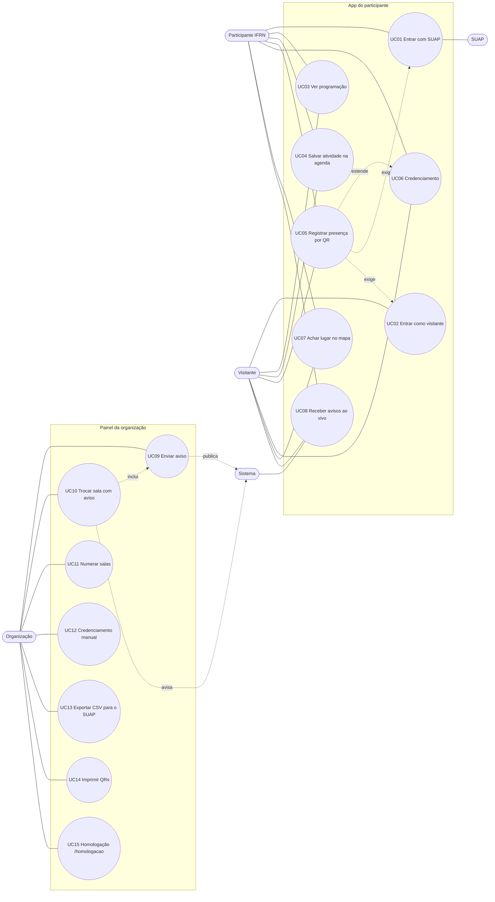

# 2. Casos de uso

## 2.1 Atores

| Ator | Descrição |
|---|---|
| Participante IFRN | Aluno ou servidor do IFRN com conta no SUAP. |
| Visitante | Pessoa de fora do IFRN. Entra com nome e e-mail. |
| Organização | Equipe do ETAL e do NADIC. Quem está em `ETAL_ORGANIZACAO` (matrícula ou e-mail) tem esse papel. A organização também é participante. |
| SUAP | Sistema acadêmico do IFRN. Autentica por OAuth2 e fornece os dados da identificação. Ator externo. |
| Sistema | O próprio ETAL Connect (API, banco, canal ao vivo). Executa passos automáticos, como avisar sobre troca de sala. |

## 2.2 Diagrama

O Mermaid não tem diagrama UML de casos de uso. O fluxograma abaixo mostra os atores à esquerda, os casos de uso no meio e o ator externo à direita.

Relações: UC10 inclui o envio de um aviso automático (mesmo mecanismo do UC09). UC05 pode credenciar quem ainda não se credenciou (comportamento do UC06). UC05 exige uma sessão aberta (UC01 ou UC02).

## 2.3 Resumo

| Id | Caso de uso | Ator principal | Situação |
|---|---|---|---|
| UC01 | Entrar com SUAP | Participante IFRN | feito |
| UC02 | Entrar como visitante (link por e-mail) | Visitante | feito |
| UC03 | Ver programação | Participante, Visitante | feito |
| UC04 | Salvar atividade na agenda | Participante, Visitante | feito |
| UC05 | Registrar presença por QR | Participante, Visitante | feito |
| UC06 | Credenciamento | Participante, Visitante | feito |
| UC07 | Achar sala, banheiro ou bebedouro no mapa | Participante, Visitante | feito |
| UC08 | Receber avisos ao vivo | Participante, Visitante | feito |
| UC09 | Enviar aviso | Organização | feito |
| UC10 | Trocar sala com aviso | Organização | feito |
| UC11 | Numerar as salas | Organização | feito |
| UC12 | Credenciamento manual | Organização | parcial |
| UC13 | Exportar CSV para o SUAP | Organização | parcial |
| UC14 | Imprimir QRs | Organização | parcial |
| UC15 | Homologação e demonstração (`/homologacao` e `/demo`) | Organização | feito |

## 2.4 Fichas

### UC01 — Entrar com SUAP

| Item | Descrição |
|---|---|
| Atores | Participante IFRN; SUAP. |
| Pré-condições | O app está registrado no SUAP (`ETAL_SUAP_CLIENT_ID` e `ETAL_SUAP_CLIENT_SECRET`). A pessoa tem conta no SUAP e não tem sessão aberta. |
| Fluxo principal | 1. Na tela de entrada (crachá), a pessoa escolhe "Entrar com o SUAP". 2. O app abre `GET /api/auth/suap`. 3. A API guarda um `state` em cookie (10 minutos) e redireciona para o SUAP. 4. A pessoa digita matrícula e senha no SUAP. 5. O SUAP redireciona para `/api/auth/suap/retorno` com `code` e `state`. 6. A API confere o `state`, troca o `code` pelo token, consulta `/api/eu/` do SUAP e cria ou atualiza a `Pessoa` pela matrícula. 7. A API define o papel (organização ou participante), abre a sessão em cookie e redireciona para `/?login=ok`. 8. O app lê `GET /api/eu` e mostra o crachá. |
| Fluxos alternativos | A1. SUAP não configurado: redireciona para `/?login=suap-indisponivel`. A2. `state` ausente ou diferente, ou sem matrícula: redireciona para `/?login=erro`. A3. SUAP fora do ar ou resposta inválida: `/?login=suap-indisponivel`. O app mostra a mensagem em aviso rápido. A4. Em desenvolvimento, `POST /api/auth/dev` entra sem SUAP. |
| Pós-condições | Sessão aberta por 30 dias. `Pessoa` com `tipo=suap` gravada. A senha não foi vista pelo app nem pela API. |
| RFs | RF01, RF03, RF04, RF05. |

### UC02 — Entrar como visitante (link por e-mail)

| Item | Descrição |
|---|---|
| Atores | Visitante. |
| Pré-condições | SMTP configurado (ou `ETAL_LOGIN_DEV=1`, que devolve o link na resposta). |
| Fluxo principal | 1. Na tela de entrada, o visitante escolhe o modo visitante e informa nome, e-mail, instituição, cidade e aceita o consentimento. 2. O app envia `POST /api/auth/visitante`. 3. A API cria a `Pessoa` (`tipo=visitante`) se o e-mail for novo. 4. A API gera um token aleatório, grava só o hash SHA-256 em `links_acesso` com validade de 30 minutos e envia o link por e-mail. 5. O visitante abre o link `GET /api/auth/link?t=...`. 6. A API marca o link como usado, abre a sessão e redireciona para `/?login=ok`. |
| Fluxos alternativos | A1. Mais de 5 pedidos por minuto do mesmo IP: 429. A2. E-mail inválido ou nome curto: 422. A3. Sem SMTP e sem modo dev: 503 "Envio de e-mail não configurado.". A4. Link expirado, já usado ou inexistente: `/?login=link-expirado`; a pessoa pede outro. A5. E-mail já cadastrado: a API reaproveita a `Pessoa` e envia novo link. |
| Pós-condições | Sessão aberta. Link inutilizável. |
| RFs | RF02, RF03, RNF11, RNF13. |

### UC03 — Ver programação

| Item | Descrição |
|---|---|
| Atores | Participante, Visitante. |
| Pré-condições | Nenhuma para a rota (é pública). O app mostra as telas após a entrada. |
| Fluxo principal | 1. Ao abrir, o app chama `GET /api/programacao` e substitui as atividades e a numeração das salas. 2. A aba Agenda lista as atividades por dia, com filtros. 3. A pessoa abre uma atividade e vê descrição, palestrante, horário, sala, vagas e inscritos. |
| Fluxos alternativos | A1. Sem conexão: o app avisa e mostra a programação de exemplo embutida (`data.js`). A2. Modo demonstração (`api: null`): sempre a programação de exemplo. |
| Pós-condições | Nenhuma alteração de dados. |
| RFs | RF06, RF07, RF33. |

### UC04 — Salvar atividade na agenda

| Item | Descrição |
|---|---|
| Atores | Participante, Visitante. |
| Pré-condições | Sessão aberta. |
| Fluxo principal | 1. Na atividade, a pessoa toca em salvar. 2. O app chama `POST /api/eu/agenda/{id}`. 3. A API confere as vagas e grava em `agenda`. 4. O app marca a atividade como salva e permite ligar o lembrete (10 minutos antes). |
| Fluxos alternativos | A1. Atividade já salva: a API responde `ok` sem duplicar. A2. Vagas esgotadas: 409 "Vagas esgotadas.". A3. Atividade inexistente: 404. A4. Sem sessão: 401. A5. Remover: `DELETE /api/eu/agenda/{id}`. |
| Pós-condições | Linha em `agenda` (única por pessoa e atividade). O número de inscritos da atividade muda. |
| RFs | RF08, RF09. |

### UC05 — Registrar presença por QR

| Item | Descrição |
|---|---|
| Atores | Participante, Visitante. |
| Pré-condições | Sessão aberta. A pessoa está na sala, onde há o QR impresso da atividade. Dentro da janela: de 20 minutos antes do início até o fim da atividade. |
| Fluxo principal (câmera do app) | 1. A pessoa toca no botão central de QR e em "Ler QR". 2. O app abre a câmera traseira e lê o código com `BarcodeDetector` ou, sem ele (computador, iPhone), com `jsQR`. 3. O app envia `POST /api/presenca` com o texto do QR. 4. A API valida a assinatura, a atividade e a janela de horário, grava `Presenca` (`via=qr`) e, se for a primeira vez, o credenciamento. 5. A API publica `lotacao` no canal ao vivo. 6. O app mostra "Presença registrada" com o nome da atividade. |
| Fluxo alternativo (câmera do celular) | 1. A pessoa aponta a câmera do celular para o QR. 2. O celular abre `https://DOMINIO/q/<token>`. 3. A API redireciona para `/?qr=<token>`. 4. O app guarda o token (`sessionStorage`), pede a entrada se a pessoa não estiver logada e, depois, envia a presença como no passo 3 acima. |
| Fluxos alternativos | A1. QR inventado ou de outro sistema: 400 "QR não reconhecido. Use um QR do ETAL.". A2. Fora da janela: 409 "Este QR vale durante a atividade (HH:MM às HH:MM do dia D).". Nada é gravado, nem o credenciamento. A3. Leitura repetida: `alreadyPresent=true`, sem duplicar. A4. Mais de 20 leituras por minuto no mesmo IP: 429. A5. Navegador sem HTTPS (a câmera exige): o app orienta a usar a câmera do celular. A6. Câmera negada: mensagem pedindo a permissão e botão "Abrir a câmera". A7. QR de outro tipo: "Esse QR não é do ETAL.". A8. Sem API: o app tira a atividade de dentro do token (base64 do JSON `{"a": id}`) ou do texto `etal:<id>`, sem servidor. No app normal o leitor usa só a câmera; os botões que simulam a leitura ficam em `/demo`. |
| Pós-condições | Linha em `presencas` (única por pessoa e atividade). `credenciado_em` preenchido, se era vazio. Lotação atualizada para os ouvintes do canal. |
| RFs | RF12, RF13, RF14, RF15, RF16, RNF10, RNF11. |

### UC06 — Credenciamento

| Item | Descrição |
|---|---|
| Atores | Participante, Visitante. |
| Pré-condições | Sessão aberta. QR do evento impresso na recepção. |
| Fluxo principal | 1. A pessoa lê o QR do evento (pelo app ou pela câmera do celular, como no UC05). 2. A API valida a assinatura (QR com atividade vazia). 3. A API grava `credenciado_em`. 4. O app mostra "Credenciamento confirmado" e o crachá passa a mostrar o horário. |
| Fluxos alternativos | A1. Já credenciada: a resposta traz `newCredential=false` e nada muda. A2. QR inválido: 400. |
| Pós-condições | `Pessoa.credenciado_em` preenchido. O QR do evento não tem janela de horário. |
| RFs | RF11, RF16. |

### UC07 — Achar sala, banheiro ou bebedouro no mapa

| Item | Descrição |
|---|---|
| Atores | Participante, Visitante. |
| Pré-condições | App aberto. Não precisa de rede para o mapa (vem do cache). |
| Fluxo principal | 1. Na Agenda ou no Mapa, a pessoa toca em "Buscar sala ou atividade". 2. Sem digitar, vê atalhos: banheiro, bebedouro, descanso e recepção. 3. Digita um termo (por exemplo, "banheiro", "bebedouro", "IA", nome de palestrante ou sala). 4. O app lista lugares ordenados por minutos a pé desde a entrada e atividades que combinam. 5. Ao escolher, o mapa mostra o lugar e traça a rota a pé da portaria até a porta, usando entrada e escada ou rampa mais rápidas. |
| Fluxos alternativos | A1. Termo sem resultado: lista vazia. A2. Atividade: abre a página dela, com botão para o mapa. A3. Em até 10 minutos antes de uma atividade salva, ao abrir o Mapa a rota já aparece, uma vez por atividade. A4. Aparelho lento: o mapa usa a versão leve ou 2D simples. |
| Pós-condições | Nenhuma alteração de dados. A última vista do mapa fica em `etal-mapa` (localStorage). |
| RFs | RF18, RF19, RF20, RF21, RNF04. |

### UC08 — Receber avisos ao vivo

| Item | Descrição |
|---|---|
| Atores | Participante, Visitante; Sistema. |
| Pré-condições | API ligada. App aberto (ou instalado, com permissão de notificação). |
| Fluxo principal | 1. Ao abrir, o app lê `GET /api/avisos` (últimos 50) e conecta em `EventSource('/api/ao-vivo')`. 2. Quando a organização envia um aviso, o canal publica o evento `aviso`. 3. O app coloca o aviso no topo da lista, vibra e mostra a notificação. 4. Eventos `sala` e `numeros` atualizam a sala das atividades e os números na planta. |
| Fluxos alternativos | A1. Conexão cai: o navegador reconecta sozinho (`retry: 5000`); o servidor envia um comentário `: ping` a cada 20 segundos para manter a conexão. A2. Fila do ouvinte cheia (100 eventos): o servidor o descarta e ele reconecta. A3. Sem API: avisos de exemplo e os do painel no mesmo navegador (`etal-org`). |
| Pós-condições | Nenhuma alteração de dados. |
| RFs | RF23, RF27. |

### UC09 — Organização envia aviso

| Item | Descrição |
|---|---|
| Atores | Organização; Sistema. |
| Pré-condições | Sessão de organização (papel `organizacao`). |
| Fluxo principal | 1. No painel, seção Avisos, a organização escreve título e texto e escolhe "Todos" ou os inscritos de uma atividade. 2. O painel chama `POST /api/org/avisos`. 3. A API grava em `avisos` e publica o evento `aviso`. 4. Todos os apps abertos recebem na hora. |
| Fluxos alternativos | A1. Sem sessão: 401. Participante comum: 403 "Só a organização do evento.". A2. Título ou texto fora do tamanho: 422. A3. Atividade inexistente: 404. |
| Pós-condições | Linha em `avisos` com autor e horário. |
| RFs | RF24, RF23. |

### UC10 — Troca de sala com aviso

| Item | Descrição |
|---|---|
| Atores | Organização; Sistema. |
| Pré-condições | Sessão de organização. Atividade existente. |
| Fluxo principal | 1. No painel, seção Programação, a organização escolhe a atividade e a nova sala (andar, zona e nome). 2. O painel chama `PATCH /api/org/atividades/{id}/sala`, com a opção de avisar os inscritos. 3. A API atualiza `andar`, `zona` e `sala`. 4. Se a opção estiver marcada, o Sistema cria o aviso "Mudança de sala" ("Atividade: agora em X. Antes era Y."). 5. A API publica `sala` e `aviso`. 6. Os apps atualizam a sala da atividade e mostram o aviso. |
| Fluxos alternativos | A1. Opção de avisar desmarcada: só o evento `sala`. A2. Atividade inexistente: 404. A3. Sem permissão: 401 ou 403. |
| Pós-condições | Atividade com nova sala. Aviso gravado, se pedido. |
| RFs | RF25, RF23. |

### UC11 — Numeração das salas

| Item | Descrição |
|---|---|
| Atores | Organização; Sistema. |
| Pré-condições | Sessão de organização. |
| Fluxo principal | 1. No painel, seção Salas, a organização digita o número de uma sala. 2. O painel chama `PUT /api/org/salas` com `{"andar:zona": "número"}`. 3. A API grava em `numeros_sala` e publica `numeros` com o mapa completo. 4. Os apps trocam o número na planta (`data-num`), nas atividades e no 3D. |
| Fluxos alternativos | A1. Número vazio: apaga a linha e volta ao número original. A2. Número com mais de 12 caracteres: é cortado em 12. |
| Pós-condições | Tabela `numeros_sala` atualizada. |
| RFs | RF26. |

### UC12 — Credenciamento manual

| Item | Descrição |
|---|---|
| Atores | Organização. |
| Pré-condições | Sessão de organização. A pessoa está cadastrada (entrou ou foi importada do SUAP). |
| Fluxo principal | 1. A organização busca a pessoa (`GET /api/org/participantes?q=`). 2. Chama `POST /api/org/credenciar/{pessoa_id}`. 3. A API grava `credenciado_em` com a hora atual. |
| Fluxos alternativos | A1. Pessoa inexistente: 404. A2. Já credenciada: nada muda. |
| Pós-condições | `credenciado_em` preenchido. |
| Observação | A API está pronta. A seção Participantes do painel ainda usa pessoas simuladas e grava só no navegador. Ligar o painel à API está planejado. |
| RFs | RF28. |

### UC13 — Exportar CSV para o SUAP

| Item | Descrição |
|---|---|
| Atores | Organização; SUAP (destino do arquivo). |
| Pré-condições | Sessão de organização. Presenças registradas. |
| Fluxo principal | 1. A organização baixa `GET /api/org/presencas.csv` (nome, matrícula, e-mail, atividade, título, quando, via) e, se quiser, `GET /api/org/credenciados.csv`. 2. Abre o arquivo (separador `;`, UTF-8 com BOM, aberto direto no Excel). 3. Lança as presenças no SUAP para emitir os certificados. |
| Fluxos alternativos | A1. Sem presenças: arquivo só com o cabeçalho. A2. Sem permissão: 401 ou 403. |
| Pós-condições | Nenhuma alteração de dados. |
| Observação | O botão de CSV do painel exporta os participantes simulados. Os arquivos reais saem pelas rotas acima. A importação no SUAP é manual. |
| RFs | RF29. |

### UC14 — Imprimir QRs

| Item | Descrição |
|---|---|
| Atores | Organização. |
| Pré-condições | Sessão de organização. Programação importada. Domínio final definido (o QR guarda o endereço do pedido, ou `ETAL_URL_PUBLICA`, se preenchida). Segredo definitivo. |
| Fluxo principal | 1. A organização abre `https://DOMINIO/api/org/qrs`. 2. A página traz uma folha para o credenciamento e uma por atividade que tem andar definido, cada uma com QR em SVG, título, sala, dia e horário. 3. Imprime e cola o QR na porta da sala. |
| Fluxos alternativos | A1. Trocar `ETAL_SEGREDO` depois de imprimir invalida todos os QRs: é preciso reimprimir. A2. Atividade sem andar não tem QR. |
| Pós-condições | Nenhuma alteração de dados. |
| Observação | Não há botão para essa página no painel; o endereço é aberto direto. |
| RFs | RF30. |

### UC15 — Homologação e demonstração (`/homologacao` e `/demo`)

| Item | Descrição |
|---|---|
| Atores | Organização (equipe de testes). |
| Pré-condições | API com `ETAL_LOGIN_DEV=1`. Opcionalmente `ETAL_SENHA_HOMOLOGACAO` define o código de entrada. |
| Fluxo principal | 1. A pessoa abre `/homologacao` (`prototipo/homologacao.html` e `homologacao.js`). 2. Informa o código de homologação; a página chama `POST /api/auth/dev` com o campo `codigo` e abre uma sessão de teste. 3. A página usa os atalhos e lista a grade de QRs vinda de `GET /api/homologacao/qrs` (um da recepção e um por atividade, com título, horário, URL e SVG). 4. Em "Ler agora", envia o QR a `POST /api/presenca` e vê o resultado. 5. Em `/demo`, o app traz botões que simulam a leitura dos QRs; com API, usam o QR assinado de `/api/homologacao/qrs`. |
| Fluxos alternativos | A1. Código errado: 403 "Código de homologação errado.". A2. `ETAL_LOGIN_DEV` desligado: `/api/homologacao/qrs` e a entrada de teste respondem 404. A3. Janela de horário ligada: o QR de atividade fora do horário responde 409 (desligar com `ETAL_JANELA_PRESENCA=false` no ambiente de teste). |
| Pós-condições | Pessoa de teste (`tipo=dev`) e presenças de teste gravadas. Não usar em produção. |
| RFs | RF17, RF04, RF12. |
