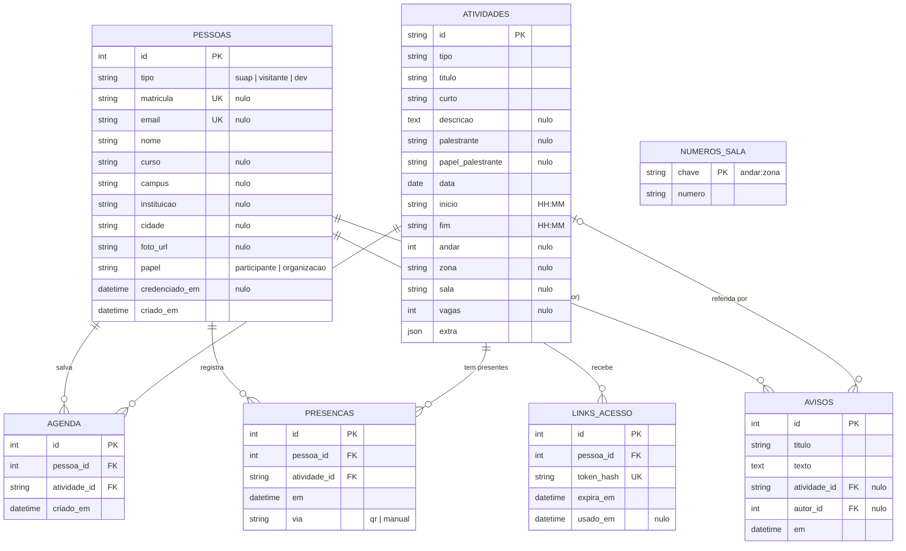

# 3. Banco de dados

O modelo está em `backend/app/modelos.py` (SQLAlchemy 2). São sete tabelas.

## 3.1 Modelo entidade-relacionamento

`NUMEROS_SALA` não tem chave estrangeira: a chave `andar:zona` aponta para as zonas da planta do app (`prototipo/plan-data.js`), que não estão no banco.

## 3.2 Dicionário de dados

### `pessoas`

Quem usa o sistema: participantes do SUAP, visitantes e a organização.

| Campo | Tipo | Nulo | Descrição |
|---|---|---|---|
| `id` | inteiro, PK | não | Identificador. |
| `tipo` | texto (16) | não | Origem: `suap`, `visitante` ou `dev` (entrada de teste). |
| `matricula` | texto (32), único | sim | Matrícula do SUAP. Chave para reconhecer a pessoa no retorno do SUAP e nos inscritos importados. |
| `email` | texto (254), único | sim | E-mail em minúsculas. Chave do visitante. |
| `nome` | texto (200) | não | Nome (o SUAP envia o nome usual). |
| `curso` | texto (200) | sim | Curso. Hoje não é preenchido pelo login do SUAP. |
| `campus` | texto (120) | sim | Campus (SUAP). |
| `instituicao` | texto (200) | sim | Instituição do visitante. |
| `cidade` | texto (120) | sim | Cidade do visitante. |
| `foto_url` | texto (500) | sim | Foto vinda do SUAP. |
| `papel` | texto (16) | não | `participante` (padrão) ou `organizacao`. Definido pela lista `ETAL_ORGANIZACAO`. |
| `credenciado_em` | data e hora | sim | Quando a pessoa foi credenciada no evento. Vazio = ainda não credenciada. |
| `criado_em` | data e hora | não | Padrão: agora (`now()` do banco). |

### `atividades`

Programação. A coluna `id` é o texto do app (por exemplo, `react-native`), para o app trocar os dados de exemplo pelos reais.

| Campo | Tipo | Nulo | Descrição |
|---|---|---|---|
| `id` | texto (64), PK | não | Identificador da atividade. |
| `tipo` | texto (40) | não | Categoria (palestra, oficina etc., como no app). |
| `titulo` | texto (300) | não | Título completo. |
| `curto` | texto (120) | não | Nome curto, usado em avisos e listas. |
| `descricao` | texto longo | sim | Descrição. |
| `palestrante` | texto (200) | sim | Nome. |
| `papel_palestrante` | texto (200) | sim | Cargo ou vínculo. |
| `data` | data | não | Dia da atividade. |
| `inicio` | texto (5) | não | Início, `HH:MM`, horário local do campus. |
| `fim` | texto (5) | não | Fim, `HH:MM`. |
| `andar` | inteiro | sim | Andar do bloco principal. Vazio = fora do bloco (sem QR impresso). |
| `zona` | texto (64) | sim | Identificador da zona na planta. |
| `sala` | texto (120) | sim | Nome da sala mostrado ao público. |
| `vagas` | inteiro | sim | Limite de inscritos. Vazio ou 0 = sem limite. |
| `extra` | JSON | não | Demais campos do app (materiais, requisitos etc.), guardados como vieram na importação. |

### `agenda`

Atividades salvas por pessoa.

| Campo | Tipo | Nulo | Descrição |
|---|---|---|---|
| `id` | inteiro, PK | não | Identificador. |
| `pessoa_id` | inteiro, FK `pessoas.id` | não | Dono da agenda. Remove em cascata. |
| `atividade_id` | texto, FK `atividades.id` | não | Atividade salva. Remove em cascata. |
| `criado_em` | data e hora | não | Quando foi salva. |

Restrição: **única** `(pessoa_id, atividade_id)`.

### `presencas`

Presença por atividade. O credenciamento no evento não fica aqui, e sim em `pessoas.credenciado_em`.

| Campo | Tipo | Nulo | Descrição |
|---|---|---|---|
| `id` | inteiro, PK | não | Identificador. |
| `pessoa_id` | inteiro, FK `pessoas.id` | não | Quem esteve presente. Cascata. |
| `atividade_id` | texto, FK `atividades.id` | não | Atividade. Cascata. |
| `em` | data e hora | não | Horário local da leitura. |
| `via` | texto (16) | não | `qr` (padrão) ou `manual`. Hoje a API só grava `qr`; `manual` está reservado. |

Restrição: **única** `(pessoa_id, atividade_id)`.

### `avisos`

| Campo | Tipo | Nulo | Descrição |
|---|---|---|---|
| `id` | inteiro, PK | não | Identificador. |
| `titulo` | texto (140) | não | Título. |
| `texto` | texto longo | não | Mensagem. |
| `atividade_id` | texto, FK `atividades.id` | sim | Atividade relacionada. Se a atividade for apagada, vira nulo (`SET NULL`). |
| `autor_id` | inteiro, FK `pessoas.id` | sim | Quem enviou. Vira nulo se a pessoa for apagada. |
| `em` | data e hora | não | Quando foi enviado. |

### `numeros_sala`

| Campo | Tipo | Nulo | Descrição |
|---|---|---|---|
| `chave` | texto (80), PK | não | `andar:zona`, como no app (por exemplo, `0:secretaria-academica`). |
| `numero` | texto (12) | não | Número definido pela organização. Sem linha = número original da planta. |

### `links_acesso`

Links de entrada por e-mail dos visitantes.

| Campo | Tipo | Nulo | Descrição |
|---|---|---|---|
| `id` | inteiro, PK | não | Identificador. |
| `pessoa_id` | inteiro, FK `pessoas.id` | não | Dono do link. Cascata. |
| `token_hash` | texto (64), único | não | SHA-256 (hexadecimal) do token. O token em si só existe no e-mail. |
| `expira_em` | data e hora | não | Criação + 30 minutos. |
| `usado_em` | data e hora | sim | Preenchido no primeiro uso. Link com valor aqui não vale mais. |

## 3.3 Restrições e regras

| Regra | Onde é garantida |
|---|---|
| Uma pessoa não salva a mesma atividade duas vezes. | `UNIQUE (pessoa_id, atividade_id)` em `agenda`; a rota também confere antes de gravar. |
| Uma pessoa tem no máximo uma presença por atividade. | `UNIQUE (pessoa_id, atividade_id)` em `presencas`; a rota confere e responde `alreadyPresent`. |
| Matrícula e e-mail não se repetem. | `UNIQUE` em `pessoas.matricula` e `pessoas.email`. Vários nulos são permitidos. |
| O token do link de visitante nunca é guardado. | Só o hash SHA-256 vai ao banco (`token_hash`, único). Quem vê o banco não consegue entrar. |
| O link expira em 30 minutos e vale uma vez. | `expira_em` e `usado_em`, conferidos em `GET /api/auth/link`. |
| Limite de vagas. | Rota de agenda: se `vagas` está preenchido e o número de linhas em `agenda` já o atingiu, responde 409. O limite não é uma restrição do banco. |
| Apagar pessoa ou atividade não deixa lixo. | `ON DELETE CASCADE` em `agenda`, `presencas` e `links_acesso`; `SET NULL` em `avisos`. |
| Chaves estrangeiras no SQLite. | A API liga `PRAGMA foreign_keys=ON` em cada conexão. |

## 3.4 SQLite e PostgreSQL

A variável `ETAL_BANCO` escolhe o banco.

| Ambiente | Valor | Observação |
|---|---|---|
| Desenvolvimento e testes | `sqlite:///./etal.db` (padrão) | Arquivo local. Conexão com `check_same_thread=False`. |
| Produção | `postgresql+psycopg://etal:SENHA@db:5432/etal` | PostgreSQL 16 no Docker Compose. Pool de 5 conexões, até 10 extras, `pool_pre_ping`. |
| Versão de teste na Vercel | PostgreSQL Neon (integração da Vercel) | A variável `DATABASE_URL` é convertida para `postgresql+psycopg` em `config.py`. Com `ETAL_SEMEAR=1`, a função cria as tabelas e importa a programação de exemplo; ver [04-arquitetura.md](04-arquitetura.md). |

Backup em produção: `docker compose exec db pg_dump -U etal etal > backup.sql`.

## 3.5 Criação das tabelas e migrações

- As tabelas são criadas no início da API (`criar_tabelas()` no ciclo de vida do FastAPI, com `Base.metadata.create_all`). Tabelas que já existem não são alteradas.
- **Não há migrações.** Mudar uma coluna num banco já em uso exige alterar o banco à mão.
- **Planejado:** migrações com Alembic, antes de qualquer mudança de esquema com dados reais.
- Dados iniciais: `python -m app.importar programacao seed/programacao.json` (21 atividades de exemplo) e `python -m app.importar inscritos arquivo.csv` (colunas `nome`, `matricula`, `email`; cria pessoas novas e não altera as existentes).
- Nos testes, o conftest recria as tabelas (`drop_all` e `create_all`) a cada cenário.
