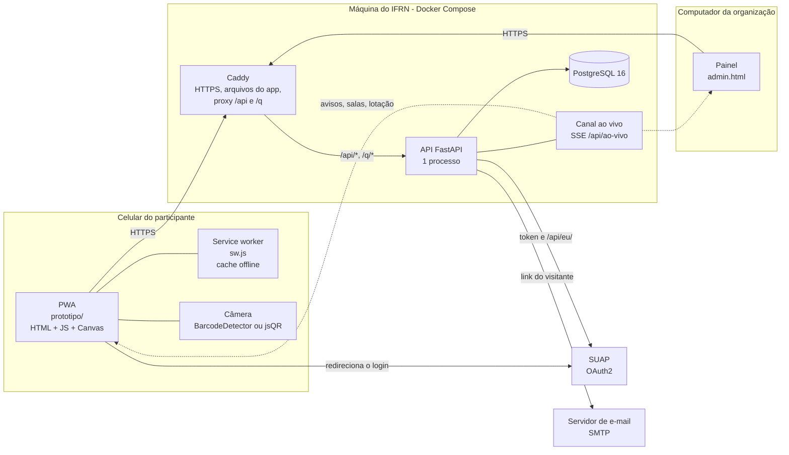
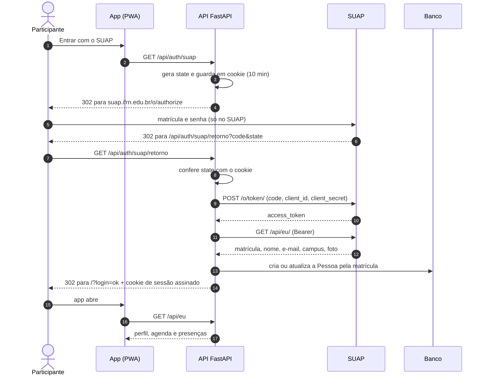
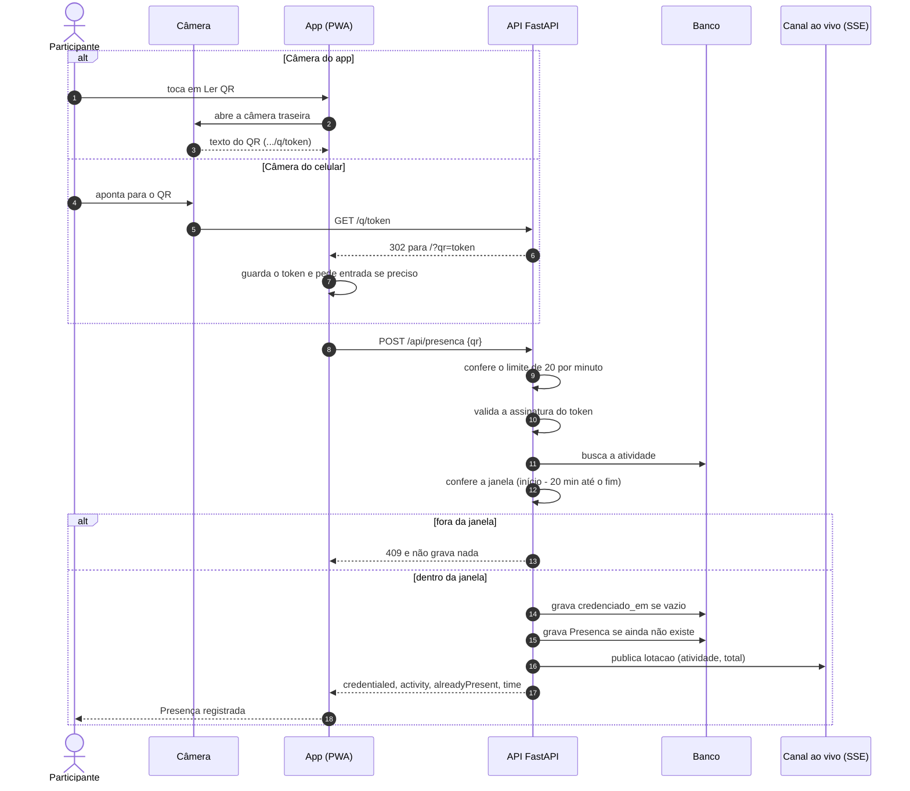
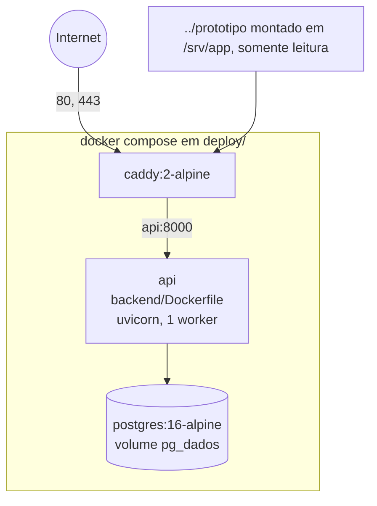
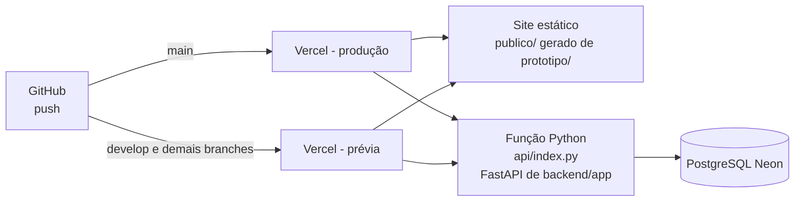
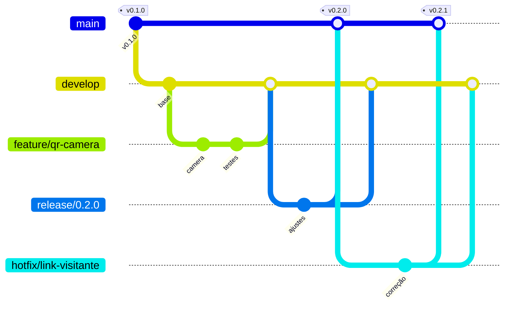

# 4. Arquitetura

## 4.1 Visão de componentes

| Componente | Papel |
|---|---|
| PWA (`prototipo/`) | Telas, mapa, agenda, leitor de QR, lembretes. Fala com a API por `api.js`. Sem framework. Leitor de QR com `BarcodeDetector` ou `jsQR`. |
| Service worker (`sw.js`) | Guarda o app para uso sem internet. Não guarda `/api/` nem `/q/`. Mostra notificações locais. |
| Painel (`admin.html`) | Versão para computador. Só a organização acessa quando a API está ligada. |
| Caddy | HTTPS automático, entrega os arquivos do app, encaminha `/api/*` e `/q/*` para a API e responde `/config.js` com `api: ''`. |
| API FastAPI (`backend/app`) | Regras de negócio, sessão, QR assinado, painel `/api/org`. Um processo só. |
| Canal ao vivo | Fila em memória por ouvinte, entregue como SSE. Eventos `aviso`, `sala`, `numeros`, `lotacao`. |
| Banco | PostgreSQL em produção, SQLite em desenvolvimento. |
| SUAP | Autentica a pessoa (OAuth2) e entrega nome, matrícula, e-mail, campus e foto. |

## 4.2 Estrutura de pastas

| Pasta | Conteúdo |
|---|---|
| `prototipo/` | O app. `index.html` (também servido em `/demo`), `homologacao.html` e `homologacao.js` (página `/homologacao`), `vendor/jsQR.js` (leitor de QR sem `BarcodeDetector`, carregado sob demanda), `app.js` (telas e lógica), `app.css`, `api.js` (cliente), `config.js` (modo), `data.js` (programação de exemplo), `campus3d.js` (motor do mapa em Canvas), `plan-data.js`, `campus-*.js`, `sprites.js` (dados do mapa), `admin.html`/`admin.js`/`admin.css` (painel), `sw.js`, `manifest.webmanifest`, `server.py` e `rodar.sh` (servidor local e login de simulação com a suapy). |
| `backend/app/` | API: `main.py` (aplicação e `/q/{token}`), `config.py`, `db.py`, `modelos.py`, `seguranca.py` (cookie e QR), `limite.py`, `ao_vivo.py` (SSE), `formatos.py` (formato de resposta igual ao do app), `importar.py` (CLI) e `rotas/` (`auth.py`, `eu.py`, `publico.py`, `org.py`). |
| `backend/tests/` | Testes de API com pytest. |
| `backend/seed/` | `programacao.json`, programação de exemplo. |
| `api/`, `vercel.json`, `requirements.txt` (raiz), `scripts/vercel-build.sh` | Versão de teste na Vercel. |
| `deploy/` | `docker-compose.yml`, `Caddyfile`, `.env.example`. |
| `.github/workflows/` | `backend.yml`: testes e implantação por SSH. |
| `scripts/` | Geradores: planta (`build-principal-plan.py` e `check-principal-plan.py`), cache offline (`build-pwa.py`), exportação do arquivo único (`export-prototipo.py`), programação de exemplo (`exportar-programacao.mjs`). |
| `docs/` | Plano técnico, páginas de contexto e esta documentação (`docs/tecnico/`). |
| `referencias/`, `maps/`, `modelo-3d/` | Levantamento do campus, plantas e cópia congelada do mapa (não editar). |
| `app/`, `components/`, `db/`, `worker/` | Primeira versão em React (Vinext). Legado; o produto é `prototipo/`. |

## 4.3 Modos do app (`prototipo/config.js`)

| `api` | Modo | Comportamento |
|---|---|---|
| `null` (padrão) | Demonstração | `window.ETAL_API` fica nulo. Dados de exemplo, entrada simulada, leitura de QR simulada. O que a organização faz fica no `localStorage` (`etal-org`). |
| `''` | Mesma origem (produção) | O app fala com `/api/...` do mesmo domínio. O Caddy entrega `config.js` com este valor. Na Vercel, o `config.js` traz também `vivo: 'consulta'` (avisos por consulta a cada 12 s, em vez de SSE). |
| `'http://127.0.0.1:8011'` | API local | Para desenvolver. A API precisa liberar a origem do app em `ETAL_ORIGENS`. |

Com a API ligada, o `apiStart()` do app lê a programação, os avisos e o perfil (`/api/eu`), abre o canal ao vivo e, sem sessão, mostra o crachá de entrada. O cliente usa `credentials: 'include'` para enviar o cookie.

## 4.4 Login com o SUAP

## 4.5 Presença por QR

## 4.6 Implantação

### Produção: máquina do IFRN

- Domínio previsto: `etal.nadic.ifrn.edu.br` (a configurar com a TI do IFRN). O Caddy pede o certificado sozinho.
- Configuração em `deploy/.env` (modelo em `.env.example`): `DOMINIO`, `POSTGRES_PASSWORD`, `ETAL_SEGREDO`, `ETAL_SUAP_CLIENT_ID`, `ETAL_SUAP_CLIENT_SECRET`, `ETAL_ORGANIZACAO`, `ETAL_SMTP_*`, `ETAL_JANELA_PRESENCA`, `ETAL_ANTECEDENCIA_MIN`.
- O compose define `ETAL_BANCO`, `ETAL_URL_PUBLICA` (com o domínio), `ETAL_ORIGENS` e `ETAL_COOKIE_SEGURO=true`.
- A imagem da API roda com usuário sem privilégios (uid 10001) e **um worker só**, porque o canal SSE vive na memória do processo.
- Subir: `cd deploy && docker compose up -d --build`. Importar a programação: `docker compose exec api python -m app.importar programacao seed/programacao.json`.
- Implantação automática (`.github/workflows/backend.yml`): na `main`, depois dos testes, se a variável `IMPLANTAR=sim` e os segredos `SSH_HOST`, `SSH_USUARIO`, `SSH_CHAVE` e `PASTA` existirem, o GitHub entra por SSH, faz `git pull --ff-only`, `docker compose up -d --build` e chama `/api/saude`.
- Pendências: acesso à máquina do NADIC (hoje recusa conexão de fora), subdomínio e registro do app no SUAP.

### Versão de teste: Vercel

Endereço: `https://etal-connect.vercel.app`. Serve para homologar sem depender da máquina do IFRN. O repositório no GitHub é privado.

| Arquivo | Papel |
|---|---|
| `vercel.json` | Roda `scripts/vercel-build.sh`, publica `publico/`, inclui `backend/{app,seed}` na função (limite de 30 s) e define as reescritas: `/api/*` e `/q/*` para a função, `/demo` para `/index.html` e `/homologacao` para `/homologacao.html`. Cabeçalhos: `no-cache` em `sw.js` e `config.js`, `nosniff` e política de referência. |
| `scripts/vercel-build.sh` | Copia o app (`*.html`, `*.js`, `*.css`, manifest, `assets/` e `vendor/`) para `publico/` e gera o `config.js` com `{ api: '', vivo: 'consulta' }`. |
| `api/index.py` | Importa `backend/app` (cria as tabelas e, com `ETAL_SEMEAR=1`, importa a programação de exemplo). |
| `requirements.txt` (raiz) | Dependências da função. |

- O banco é PostgreSQL no Neon, pela integração da Vercel (`DATABASE_URL`).
- Deploy automático a cada push no GitHub: `main` publica a produção e as demais branches (como `develop`) geram prévias.
- **Avisos ao vivo:** o SSE em memória não funciona em funções. Com `vivo: 'consulta'`, o `api.js` consulta `/api/avisos` e `/api/programacao` a cada 12 segundos.
- `ETAL_URL_PUBLICA` fica vazia: a API usa o endereço do pedido (`x-forwarded-host` e `x-forwarded-proto`).
- Usar só dados fictícios (RNF16). A entrada de teste (`ETAL_LOGIN_DEV=1`) e `/homologacao` ficam ligadas nesta versão.

## 4.7 Fluxo de trabalho no Git (git flow)

| Branch | Para quê | Nasce de | Volta para |
|---|---|---|---|
| `main` | Código em produção. Cada versão recebe uma tag `vX.Y.Z`. Dispara a implantação. | — | — |
| `develop` | Integração do próximo lançamento. Gera a prévia. | `main` | — |
| `feature/*` | Uma funcionalidade ou correção não urgente. | `develop` | `develop` |
| `release/*` | Preparo de uma versão: ajustes finais, versão do cache (`npm run pwa`), testes de homologação. | `develop` | `main` e `develop` |
| `hotfix/*` | Correção urgente em produção. | `main` | `main` e `develop` |

Regras:

- Tags seguem versionamento semântico: `vX.Y.Z` (X: mudança incompatível; Y: funcionalidade nova; Z: correção).
- O CI (`backend.yml`) roda os testes em todo push que mexe em `backend/`, `deploy/` ou `prototipo/` e em pull request com mudanças em `backend/`.
- A implantação por SSH só roda na `main`.
- Depois de mudar arquivos do app, rodar `npm run pwa` para renovar a versão do cache offline.
- Neste repositório já existem as branches `main` e `develop` e as tags `v0.1.0` e `v0.2.0`.
